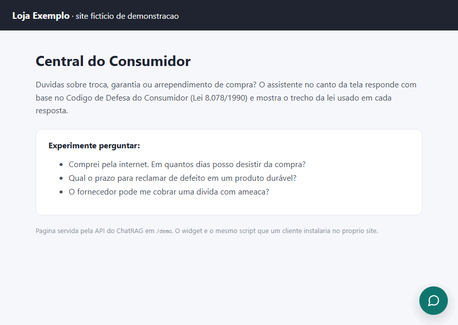
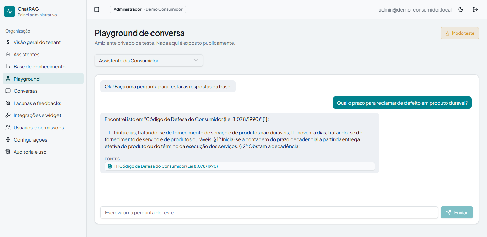
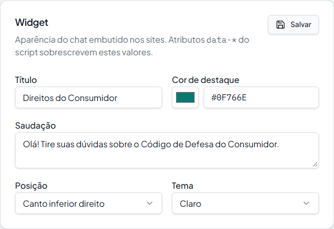
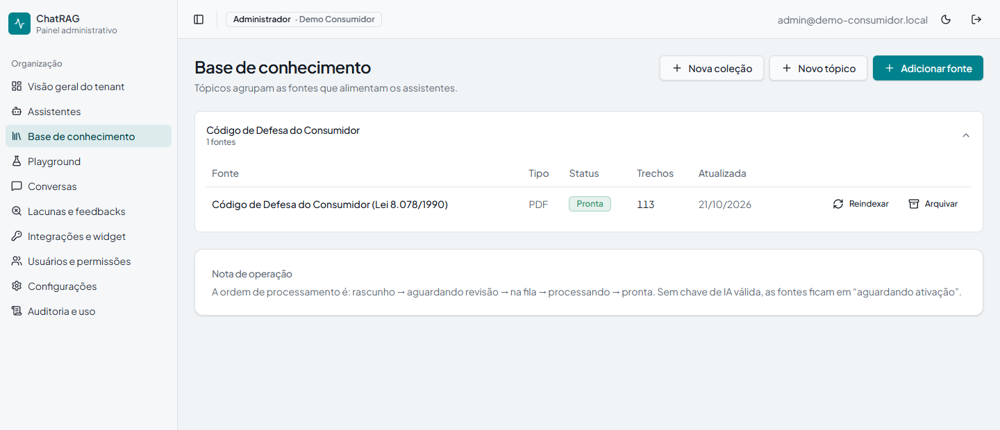
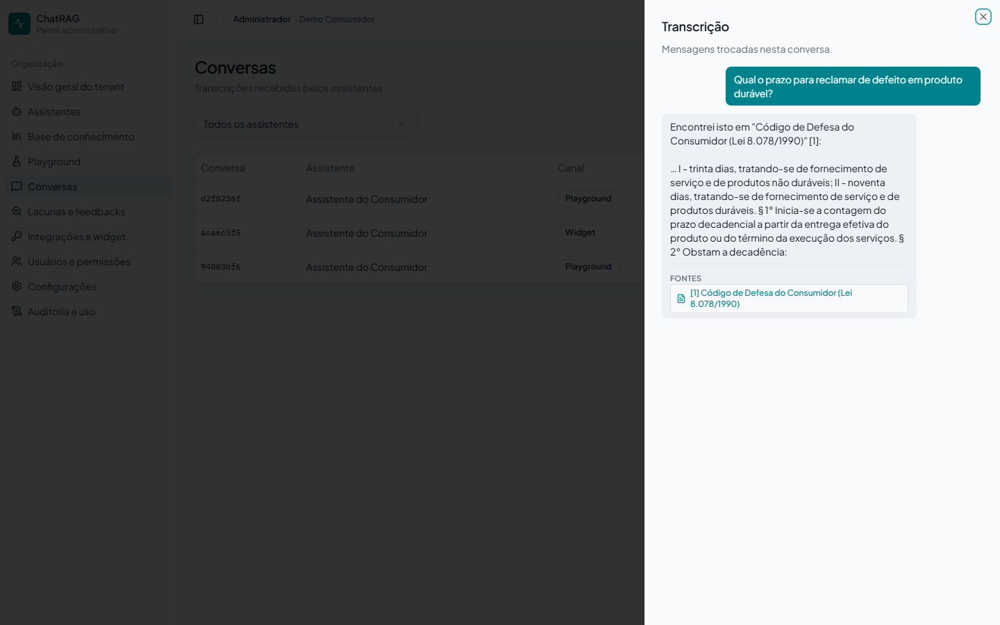
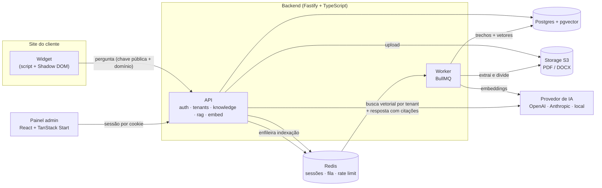

# ChatRAG

Plataforma multi-tenant de chatbots com RAG: você envia documentos, e um widget embutido no seu site responde perguntas com base neles — citando o trecho e o documento de origem.



## Por que fiz

Trabalho com IA aplicada ao jurídico, onde uma resposta sem fonte não vale nada. Quis construir de ponta a ponta um RAG que só responde com base nos documentos do cliente, mostra de onde tirou cada resposta e isola os dados de cada empresa.

## Funcionalidades

- **Upload → indexação → resposta com fonte:** PDF, DOCX, texto ou URL viram trechos com embeddings (pgvector + HNSW). Cada resposta cita o trecho e o documento usados.
- **Modo estrito:** sem contexto relevante, o assistente não inventa. A pergunta vira uma "lacuna", que o time responde no painel criando uma nova fonte.
- **Multi-tenant de verdade:** toda consulta filtra por organização. O Master só vê dados de um tenant abrindo uma sessão de suporte justificada e auditada.
- **Provedor de IA configurável por `.env`:** OpenAI, Anthropic (Claude) ou modo local sem chave. Embeddings via OpenAI ou com um modelo multilíngue rodando no próprio container.
- **Widget embutível:** um `<script>` de ~17 kB, sem dependências e isolado em Shadow DOM. A aparência (título, cor, posição, tema) é configurada no painel, e só domínios autorizados podem usá-lo.
- **Painel administrativo:** assistentes, base de conhecimento, playground, conversas, lacunas, chaves do widget, usuários, auditoria e uso.
- **Segurança:** chaves BYOK dos tenants com envelope encryption, chaves do widget guardadas só como hash, rate limit e proteção contra prompt injection no prompt do sistema.

| Playground com fontes | Aparência do widget no painel |
| --- | --- |
|  |  |

| Base de conhecimento | Conversas com as fontes de cada resposta |
| --- | --- |
|  |  |

## Como rodar

Requisito: Docker. Não precisa de nenhuma chave de API.

```bash
git clone https://github.com/wandercosta/chat-rag.git && cd chat-rag
cp .env.example .env
docker compose up --build
```

O primeiro build leva alguns minutos, porque baixa o modelo de embeddings (~120 MB). Depois disso, o serviço `seed` cria um tenant de demonstração e indexa o [Código de Defesa do Consumidor](backend/seed/) (Lei 8.078/1990, domínio público). Quando o log mostrar `✓ Seed concluido`:

- **Widget:** <http://localhost:3333/demo> — pergunte, por exemplo, "Comprei pela internet. Em quantos dias posso desistir?"
- **Painel:** <http://localhost:3000> — entre com `DEMO_ADMIN_EMAIL` / `DEMO_ADMIN_PASSWORD` do `.env`

Sem chave, o assistente roda em **modo local**: ele responde com o trecho mais relevante da lei e cita a fonte. Para respostas geradas por um LLM, preencha no `.env` `AI_PROVIDER=anthropic` e `ANTHROPIC_API_KEY` (ou `AI_PROVIDER=openai` e `OPENAI_API_KEY`) e rode `docker compose up -d` de novo.

## Arquitetura



**Fluxo de uma pergunta:** o widget envia a pergunta com a chave pública. A API valida a chave e o domínio de origem, gera o embedding da pergunta e busca no pgvector só os trechos que aquele assistente pode ver. Se nenhum trecho passar do limiar de relevância, a pergunta vira lacuna. Se passar, os trechos vão numerados para o modelo, que responde citando `[n]`, e a resposta volta com as citações (documento + trecho).

## Tecnologias

| Camada | Stack |
| --- | --- |
| Painel | React 19, TanStack Start/Router/Query, Tailwind CSS 4, Radix/shadcn |
| API e worker | Node 22, Fastify 5, TypeScript, Kysely, Zod, BullMQ, argon2 |
| Dados | PostgreSQL 16 + pgvector (HNSW), Redis 7, storage S3 (SeaweedFS no Docker) |
| IA | OpenAI SDK, Anthropic SDK, transformers.js (`multilingual-e5-small`, ONNX) |
| Widget | TypeScript sem framework, Vite (bundle IIFE), Shadow DOM |
| Qualidade | Vitest (unitário + integração com Postgres/Redis reais), dependency-cruiser (fronteiras de módulo), GitHub Actions |
| Infra | Docker Compose |

## Estrutura de pastas

```text
.
├── src/                  # Painel admin (rotas, componentes, cliente da API)
├── widget/               # Widget embutível (bundle único, sem dependências)
├── backend/
│   ├── src/modules/      # identity, organizations, assistants, knowledge, rag,
│   │                     # conversations, embed, audit, analytics
│   ├── src/bootstrap/    # migrations no boot, bucket, usuário Master, seed
│   ├── migrations/       # schema do Postgres (node-pg-migrate)
│   └── seed/             # PDF do CDC usado na demonstração
├── docs/                 # arquitetura, ADRs, contratos, segurança, roadmap
├── infra/                # init do Postgres (extensão pgvector)
└── docker-compose.yml    # stack completa; docker-compose.infra.yml = só infra
```

Os módulos do backend só conversam pelo `index.ts` de cada um, regra checada no CI pelo dependency-cruiser. As decisões de arquitetura estão em [`docs/decisions/`](docs/decisions/).

## Testes

```bash
cd backend && npm ci && npm test
```

Os testes de integração (`npm run test:integration`) sobem a API de verdade contra Postgres e Redis e cobrem login, criação atômica de tenant, upload de PDF, indexação e pergunta com citação. O passo a passo está em [`backend/README.md`](backend/README.md#testes).

## O que aprendi

- **O limiar de relevância é o que segura a alucinação.** Medi as distâncias de perguntas dentro e fora do escopo (`scripts/debug-retrieval.ts`) e calibrei um limiar para cada modelo de embeddings. Cada modelo distribui as distâncias numa faixa diferente, então um limiar fixo não serve para todos.
- **Chat e embeddings são decisões separadas.** O chat pode vir do tenant ou da plataforma, mas os embeddings precisam ser do deploy inteiro: vetores de modelos diferentes na mesma coluna deixam a busca sem sentido. A Anthropic, por exemplo, não oferece embeddings ([ADR-005](docs/decisions/ADR-005-provedor-de-ia-da-plataforma.md)).
- **Teste de integração pega o que teste unitário não pega.** Um hook de sessão preso ao escopo de um plugin do Fastify derrubava toda rota fora do módulo de identidade. Só um teste HTTP de verdade, atravessando módulos, mostrou o problema.
- **Isolamento de tenant tem que estar na query, não na tela.** Todo repositório recebe `organization_id`, e a busca vetorial filtra por organização e pelos tópicos que o assistente pode consultar.
- **Rodar do zero é uma funcionalidade.** O `docker compose up` em um clone limpo revelou scripts de bootstrap que não entravam no build e uma imagem de storage que tinha saído do ar. Hoje esse caminho faz parte do processo.
